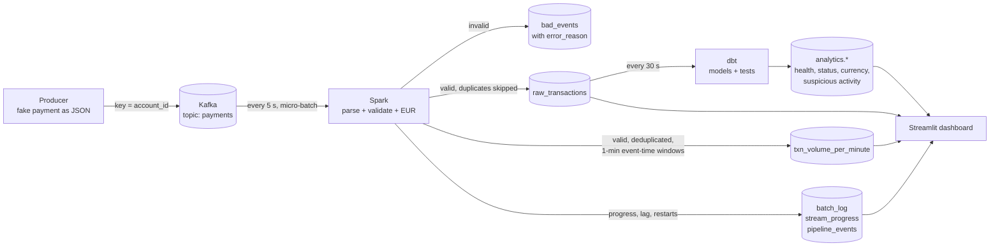

# Real-Time Financial Transaction Data Platform

A student data-engineering project: a streaming pipeline that processes **synthetic** payment
events and turns them into transaction-monitoring numbers, shown on a live dashboard.

> This is a data platform demo. All data is fake, and the "suspicious activity" indicators are
> simple simulated rules. This is **not** a production fraud detector.

[](https://cheugs-txn-monitor.streamlit.app/)

**Live demo:** https://cheugs-txn-monitor.streamlit.app/  
*A replay of a real pipeline run (the full Kafka + Spark stack runs locally with Docker, see section 13).*

**Contents:**
[1. Overview](#1-project-overview) ·
[2. Business context](#2-business-context--mission) ·
[3. Objectives](#3-project-objectives) ·
[4. Architecture](#4-system-architecture) ·
[5. Data model](#5-data-model--event-schema) ·
[6. Challenges](#6-engineering-challenges--solutions) ·
[7. Processing logic](#7-data-processing--business-logic) ·
[8. Decisions](#8-engineering-decisions--trade-offs) ·
[9. Results](#9-results--performance-benchmarks) ·
[10. Dashboard](#10-dashboard--monitoring) ·
[11. Testing](#11-testing--reliability) ·
[12. Stack](#12-technology-stack) ·
[13. Installation](#13-installation--execution) ·
[14. Limitations](#14-limitations--future-improvements) ·
[15. Skills](#15-skills-demonstrated)

---

## 1. Project Overview

A Python producer sends fake card payments to **Kafka**. A **PySpark Structured Streaming** job
reads them continuously, checks them, removes duplicates, converts amounts to EUR and counts
them per minute. The results go to **PostgreSQL**, **dbt** builds analytics tables on top, and a
**Streamlit** dashboard shows everything live. All of it runs with one Docker command.

**At a glance:**
- **Run it:** `docker compose up -d --build`
- **What it proves:** event-time windows, duplicate handling, late events with a watermark,
  replay from Kafka, schema evolution, and no lost or double-counted transactions after a crash
- **Tested:** 41 unit and integration tests, 11 end-to-end tests, 26 dbt data tests, and a CI workflow
- **Measured:** 1,000,000 events processed at about 3,000 events/s, with 0 lost and 0 duplicated
- **Checklist:** every acceptance item is linked to its evidence in [docs/CHECKLIST.md](docs/CHECKLIST.md)

## 2. Business Context & Mission

Banks and payment companies receive a constant stream of transactions. Their teams need to know,
within seconds, how much money is moving, whether the systems are keeping up, and whether some
activity looks unusual. The data behind those answers is messy: messages arrive late or out of
order, some are sent twice, some are broken, and the message format changes over time.

**Mission:** build a small but realistic data platform that turns this messy stream into numbers
people can **trust**. Each payment is counted exactly once, in the minute it really happened,
and broken data is set aside with a reason instead of being lost.

## 3. Project Objectives

1. Generate realistic synthetic payments, including messy data on purpose.
2. Ingest them through Kafka and process them continuously with Spark.
3. Use **event time** (not arrival time) for all time-based numbers.
4. Handle duplicates, late events, invalid records and schema changes correctly.
5. Recover after a crash without losing or double-counting transactions, and allow a full replay.
6. Store clean, well-structured results in PostgreSQL and model them with dbt.
7. Show volumes, delays and simulated suspicious-activity indicators on a live dashboard.
8. Prove all of this with automated tests and a performance benchmark.

## 4. System Architecture

```
 ┌──────────┐   ┌──────────────┐   ┌────────────────────────────┐   ┌──────────────┐   ┌───────────┐
 │ producer │──▶│ Kafka        │──▶│ PySpark Structured         │──▶│ PostgreSQL   │──▶│ Streamlit │
 │ (Python) │   │ topic        │   │ Streaming                  │   │ public.*     │   │ dashboard │
 └──────────┘   │ "payments"   │   │  1. parse JSON             │   │  raw + stream│   └───────────┘
                │ 3 partitions │   │  2. validate + FX to EUR   │   │  monitoring  │         ▲
                │ 7-day retain │   │  3a. raw_sink   (dedup)    │   └──────┬───────┘         │
                └──────────────┘   │  3b. volume_per_min        │          │                 │
                                   │      (watermark + window)  │   ┌──────▼───────┐         │
                                   └────────────────────────────┘   │ dbt          │─────────┘
                                                                    │ analytics.*  │
                                                                    └──────────────┘
```

| Component | Responsibility | Code |
|-----------|----------------|------|
| Producer | Generates fake payments, plus messy data on purpose (duplicates, late, invalid, malformed, 2 schema versions) | [producer/](producer/) |
| Kafka | Durable event log that can be replayed. Topic `payments` is created by `kafka-init` with 3 partitions (key = `account_id`) and 7-day retention | [docker-compose.yml](docker-compose.yml) |
| Spark | Parses and validates events, converts to EUR, removes duplicates, builds event-time windows, and writes idempotently to Postgres | [spark/](spark/) |
| PostgreSQL | `public` holds raw data, streaming aggregates and monitoring tables. `analytics` holds the dbt models | [sql/init.sql](sql/init.sql) |
| dbt | A staging view and mart tables (health, status, currency, suspicious activity). Data tests run every 30 s | [dbt/](dbt/) |
| Dashboard | Live KPIs, volumes, latency, throughput, Kafka lag, data quality and indicators | [dashboard/](dashboard/) |

### Data flow: the journey of one payment



**Step by step:**

1. **Created.** The producer makes a payment (for example 34.50 GBP from account `ACC0042`) and gives it a unique `event_id` and an `event_time`, which is when the payment happened.
2. **Stored in Kafka.** The message goes to the `payments` topic. The key is `account_id`, so all payments of one account land in the same partition, in order. Kafka saves the arrival time (`kafka_time`) and keeps the message for 7 days, so it can be replayed.
3. **Read by Spark.** Every 5 seconds Spark reads the new messages as one micro-batch. It saves its position (the Kafka offsets) in a checkpoint, so after a crash it continues from the same place.
4. **Checked and converted.** Spark turns the JSON into columns, checks the data-quality rules (section 7), and converts the amount to EUR with the `fx_rates` table.
5. **Split into two streams:**
   - **Raw path:** every valid payment is written to `raw_transactions` once. A copy with the same `event_id` is skipped and counted in `batch_log`. An invalid record goes to `bad_events` with the reason.
   - **Window path:** valid payments are deduplicated and counted per 1-minute window of **event time**. A late payment (up to 10 minutes) updates the minute it belongs to, and the result is upserted into `txn_volume_per_minute`.
6. **Monitored.** Each batch writes its numbers to `batch_log`, Spark's progress (throughput, Kafka lag) goes to `stream_progress`, and starts, restarts and replays go to `pipeline_events`.
7. **Modelled by dbt.** Every 30 seconds dbt rebuilds the `analytics` tables from the raw data (pipeline health, status mix, currency mix, simulated suspicious-activity indicators) and runs its 26 data tests.
8. **Shown.** The dashboard reads Postgres every 5 seconds. A payment is usually on the dashboard about **2–5 seconds** after it reaches Kafka.

**Where a record can end up:**

| The record is… | Where it goes | Counted in windows? |
|----------------|---------------|---------------------|
| Valid and new | `raw_transactions` + its 1-minute window | Yes |
| A duplicate (same `event_id`) | Skipped, counted in `batch_log.duplicates_skipped` | No (already counted) |
| Invalid or malformed | `bad_events`, with `error_reason` | No |
| Late, but within 10 minutes | `raw_transactions` + the window of the minute it happened | Yes |
| Later than 10 minutes | `raw_transactions` only (kept, never lost) | No (window already closed) |

**Online demo flow:** the [live dashboard](https://cheugs-txn-monitor.streamlit.app/) cannot run Kafka and Spark for free,
so `scripts/export_snapshot.py` copies a few hours of a real run from the local Postgres to a cloud
Postgres (Neon), and the online dashboard reads that copy in demo mode (section 10).

**Traceability:**
- Every row in `raw_transactions` keeps its `kafka_partition` and `kafka_offset`, so you can trace it back to the exact Kafka message. Invalid messages in `bad_events` are keyed by the same Kafka position.
- `batch_log` records every Spark micro-batch, and `stream_progress` records every progress report (with its `run_id`).
- `pipeline_events` records every start, restart, failure and replay.

## 5. Data Model & Event Schema

**Event, schema v1**

```json
{"event_id": "uuid", "schema_version": 1, "account_id": "ACC0042", "merchant_id": "MER007",
 "amount": 34.50, "currency": "GBP", "country": "GB", "status": "APPROVED",
 "event_time": "2026-11-01T12:00:00.123Z"}
```

**Schema v2** adds two optional fields: `payment_method` and `device_id`.

| Table | Written by | Contents |
|-------|-----------|----------|
| `fx_rates` | init.sql | Fixed **demo** exchange rates to EUR (not live rates) |
| `raw_transactions` | Spark | Every valid event, stored once (`event_id` primary key), with `amount_eur` |
| `bad_events` | Spark | Rejected records + `error_reason` (dead-letter table) |
| `txn_volume_per_minute` | Spark | Count, EUR amount, status counts and delays per 1-minute event-time window |
| `batch_log` | Spark | Per micro-batch: received, inserted, duplicates skipped, invalid |
| `stream_progress` | Spark | Throughput, batch duration and **Kafka consumer lag** per batch |
| `pipeline_events` | Spark / replay script | Fresh start, restart from checkpoint, query failure, replay |
| `analytics.stg_transactions` | dbt | Cleaned view with delay columns |
| `analytics.pipeline_health_per_minute` | dbt | Latency, late events and schema versions per minute |
| `analytics.status_per_minute` | dbt | Distribution by status |
| `analytics.volume_by_currency` | dbt | Amount per currency (local and EUR) |
| `analytics.suspicious_activity` | dbt | Simulated rule-based indicators |

**Indexes** (explained in `init.sql`):
- `raw_transactions(event_time)`: the dashboard and dbt filter by event-time ranges.
- `raw_transactions(account_id, event_time)`: the suspicious-activity rules group by account over time.
- `raw_transactions(processed_at)`: the "latency in the last 5 minutes" KPI reads only recent rows.
- `stream_progress(batch_timestamp)`: the dashboard charts read the last hour of progress.

## 6. Engineering Challenges & Solutions

| Challenge | Solution |
|-----------|----------|
| **Event time vs processing time:** a payment can reach us minutes after it happened | Windows are grouped by `event_time`. Three timestamps are stored (`event_time`, `kafka_time`, `processed_at`), so delays can be measured |
| **Duplicates:** the source re-sends about 3% of events | Spark `dropDuplicates(["event_id", "event_time"])` keeps window totals correct. Postgres `ON CONFLICT (event_id) DO NOTHING` keeps the raw table clean. Skipped copies are counted in `batch_log` |
| **Late and out-of-order events** | A 10-minute watermark: a late event inside the watermark updates its old window. Events later than that are left out of the windows but are still stored in `raw_transactions` |
| **Replayability** | Kafka keeps 7 days of events. `scripts/replay.ps1` (or `replay.sh`) clears the outputs and checkpoints, and Spark re-reads the topic from the start. Tested: the same event IDs come back |
| **Schema evolution** | The Spark schema has the fields of every version. v1 events get `NULL` for new fields, unknown future fields are ignored, and a missing `schema_version` means v1 |
| **Delivery guarantees** | See the table below. Database errors are retried 3 times, the container restarts after a crash, and `failOnDataLoss=true` stops the job rather than silently skipping data |

**Delivery guarantees, step by step:**

| Step | Guarantee | How |
|------|-----------|-----|
| Producer → Kafka | No duplicates from retries | `acks=all`, `enable.idempotence=true` |
| Source system | At-least-once (it may re-send) | Simulated 3% duplicates |
| Kafka → Spark | At-least-once | Offsets are saved in the checkpoint. After a crash, the unfinished batch runs again |
| Spark → Postgres | Idempotent writes | Upserts keyed on `event_id` / `window_start` / Kafka position. `batch_log` is written in the same transaction |
| **End result** | **Effectively exactly-once in Postgres** | At-least-once processing + idempotent writes |

**Key terms:**

| Term | Meaning in this project |
|------|-------------------------|
| Event time | When the payment happened (`event_time`), not when we received it |
| Watermark | How long Spark waits for late events (10 minutes) before it closes a time window |
| Micro-batch | Spark reads new Kafka messages every 5 seconds and processes them as one small batch |
| Checkpoint | A folder where Spark saves its progress, so it can continue after a restart |
| Idempotent write | Writing the same data twice gives the same result as writing it once |
| Upsert | `INSERT ... ON CONFLICT`: insert a new row, or update the row if it already exists |
| Exactly-once result | Each transaction is counted once in the database, even if it was processed twice |
| Dead-letter table | `bad_events`: where invalid records go, with the reason, instead of being lost |
| Kafka consumer lag | How many messages are in Kafka but not processed yet |

## 7. Data Processing & Business Logic

**Step by step, for every micro-batch** ([spark/transformations.py](spark/transformations.py)):
1. **Parse** the JSON message into typed columns.
2. **Validate** it. The first rule that fails is stored as `error_reason`, and the record goes to `bad_events`.
3. **Convert** the amount to EUR with the `fx_rates` table, so totals never mix currencies.
4. **Store** valid events in `raw_transactions` (duplicates skipped).
5. **Aggregate** by 1-minute event-time window: count, EUR total, approved/declined, delays and late events.

**Data quality rules:**

| Rule | `error_reason` |
|------|----------------|
| Not valid JSON | `malformed_json` |
| `event_id` / `account_id` / `amount` / `event_time` missing | `missing_*` |
| Timestamp can't be parsed | `invalid_event_time` |
| Timestamp more than 5 minutes in the future | `event_time_in_future` |
| Amount below 0.01 | `non_positive_amount` |
| Currency missing or not in `fx_rates` | `unknown_currency` |
| More than 1,000,000 EUR | `amount_too_large` |
| Status not APPROVED / DECLINED / PENDING | `invalid_status` |

Postgres repeats the most important rules as constraints (`CHECK amount > 0`, a foreign key on
currency, `CHECK status IN ...`), and dbt tests check them again on the stored data.

**Simulated suspicious-activity indicators** ([dbt/models/marts/suspicious_activity.sql](dbt/models/marts/suspicious_activity.sql)).
Each flagged row has a sentence that explains why. The thresholds are dbt vars in [dbt/dbt_project.yml](dbt/dbt_project.yml).

| Rule | Flagged when |
|------|--------------|
| High velocity | 6 or more payments from one account in 5 minutes |
| Large amount | One payment of 3,000 EUR or more (compared in EUR, so 3,000 XAF is not flagged) |
| Country hopping | Payments from 3 or more countries by one account within one hour |

## 8. Engineering Decisions & Trade-offs

| Decision | Why | Trade-off |
|----------|-----|-----------|
| `foreachBatch` + psycopg2 upserts instead of the JDBC sink | JDBC can't do `ON CONFLICT`, and idempotent writes are what give exactly-once results | Each batch is collected to the driver. Fine for thousands of events/s, not millions |
| Two streaming queries (raw + windows) | The raw table must keep **every** event, even ones beyond the watermark | The two queries commit at slightly different times |
| Validation in Spark and constraints in Postgres | Bad records are isolated early with a reason, and the database is a second safety net | The rules live in two places, and unit tests keep them in line |
| FX rates loaded once at start-up | Simple, and amounts are never mixed between currencies | Rates are fixed demo values. Changing them needs a Spark restart |
| RocksDB state store | Dedup and window state stays on disk, not in JVM memory | Slightly slower than in-memory for tiny workloads |
| Watermark of 10 minutes | Accepts typical late events (seconds to minutes) | Window results are final only after 10 minutes, and later events don't count in windows |
| dbt full rebuild every 30 s | Easy to understand | Doesn't scale to very large tables (incremental models would) |
| JSON instead of Avro + Schema Registry | Easy to read and debug | Schema rules live in code, with no registry enforcing compatibility |

## 9. Results & Performance Benchmarks

Measured on a laptop: Docker Desktop with 12 CPUs and 8 GB, Spark in `local[4]`. Full details and
the bottleneck analysis are in [docs/PERFORMANCE.md](docs/PERFORMANCE.md).

| | 100,000 events | 1,000,000 events |
|---|---|---|
| Stored / lost / duplicated | 100,000 / **0** / **0** | 1,000,000 / **0** / **0** |
| End-to-end throughput | **3,725 events/s** | **2,986 events/s** |
| Spark throughput (avg per batch) | 4,445 events/s | 4,366 events/s |
| Producer → Kafka | about 42,000 events/s | about 44,000 events/s |

- **Normal load** (5 events/s): latency from Kafka to Postgres is about **2.5 s** (p50) and 4.8 s (p95).
- **Under a burst** of 1M events, most of the waiting time is the queue in Kafka. Kafka lag went up to 940,000 messages and then back to 0.
- **Main bottlenecks:** the dedup/window state in Spark, and collecting each batch to the driver before writing.

Run a benchmark yourself:

```bash
python scripts/run_benchmark.py 100000
```

## 10. Dashboard & Monitoring

Open **http://localhost:8501**. The sidebar has five pages, and each page answers one question:

| Page | Question it answers |
|------|---------------------|
| Overview | Is the pipeline healthy, and how much money is moving? |
| Transactions | Volumes per minute, EUR amounts, status mix, currency mix |
| Pipeline | Throughput, Kafka lag, latency, schema versions, and a log of starts, restarts and replays |
| Data quality | Invalid records by reason, duplicates skipped, late events |
| Risk indicators | The three simulated rules and the flagged activity |

- The data refreshes every 5 seconds, and a time-range filter (15 min – 24 h) sits in the sidebar.
- A health badge says *Healthy*, *Catching up* or *Stalled*, based on Kafka lag and the time since the last batch.
- The chart colours were checked for colour-blind readers.
- Motion is switched off when the operating system asks for reduced motion.

**Online version ([https://cheugs-txn-monitor.streamlit.app/](https://cheugs-txn-monitor.streamlit.app/)):** the full pipeline is too heavy for free hosting, so the online dashboard
(Streamlit Community Cloud + Neon Postgres) shows a **snapshot of a real run** in *demo mode*.
`scripts/export_snapshot.py` copies the data, and [docs/DEPLOYMENT.md](docs/DEPLOYMENT.md) has every step.

**Monitoring tables** behind the dashboard: `stream_progress` (throughput, lag), `batch_log`
(duplicates, invalid rows), `pipeline_events` (recoveries), plus Python logs in every container.

## 11. Testing & Reliability

| Level | What is tested | How to run |
|-------|----------------|-----------|
| Unit (34) | Generator, every validation rule, window maths, FX conversion | `docker compose run --rm tests` |
| Integration (7) | Real streaming queries, one micro-batch at a time: out-of-order, late, beyond watermark, duplicates, schema evolution, malformed data, restart from checkpoint | (same command) |
| Data tests (26) | dbt: unique, not-null, relationships, accepted values, valid amounts, windows not inflated, no future events, schema versions | Run every 30 s by the `dbt` container |
| End-to-end (9) | On the running stack: ingestion, duplicates, invalid records, schema v1/v2/v3, late events, monitoring, dashboard vs database, dbt, Spark restart | `pytest tests/e2e -m "not slow"` |
| Slow end-to-end (2) | Postgres outage, full replay (**replay clears the tables!**) | `pytest tests/e2e -m slow` |

**Reliability scenarios that are tested:**
- Spark is restarted while events are flowing. Result: nothing is lost or doubled, and the recovery is logged.
- Postgres is stopped for 20 seconds. Result: the writes are retried, Spark restarts, and every event arrives.
- A full replay from Kafka gives back exactly the same event IDs.

**CI:** [.github/workflows/ci.yml](.github/workflows/ci.yml) runs the unit and integration tests,
then starts the whole stack in Docker and runs the end-to-end tests on every push.

## 12. Technology Stack

| Area | Tool | Version |
|------|------|---------|
| Language | Python | 3.12 (producer, dashboard), 3.8 (Spark image) |
| Messaging | Apache Kafka (KRaft, no Zookeeper) | 3.8.0 |
| Stream processing | PySpark Structured Streaming + RocksDB state store | 3.5.3 |
| Database | PostgreSQL | 16 |
| Transformation | dbt-postgres | 1.8 |
| Dashboard | Streamlit + Plotly | 1.39 / 5.24 |
| Containers | Docker Compose | v2 |
| Testing | pytest, dbt tests, GitHub Actions | |

## 13. Installation & Execution

You need **Docker Desktop** with at least 4 GB of memory.

**1. Create your settings file** and set your own `POSTGRES_PASSWORD` in it:

```bash
cp .env.example .env
```

**2. Start everything** (the first start takes a few minutes, while Spark downloads the Kafka connector):

```bash
docker compose up -d --build
```

**3. Open the dashboard** at http://localhost:8501 (Spark UI: http://localhost:4040).

**Run the tests:**

```bash
docker compose run --rm tests
```

```bash
pip install -r requirements-dev.txt
```

```bash
pytest tests/e2e -m "not slow"
```

**Replay everything from Kafka** (Windows; use `sh scripts/replay.sh` on Mac or Linux):

```powershell
.\scripts\replay.ps1
```

**Stop:**

```bash
docker compose down
```

(`docker compose down -v` also deletes all data, Kafka topics and checkpoints.)

**Configuration:** every setting is an environment variable in `.env`:
- Postgres credentials
- producer rate
- Spark watermark, window size, trigger interval, batch size and cores

`.env` is git-ignored. Only `.env.example` is committed.

**Project structure:**

```
├── docker-compose.yml       all services (+ "tests" profile)
├── .env.example             configuration template (copy to .env)
├── producer/                generator.py, producer.py, benchmark_load.py
├── spark/                   transformations.py (logic), streaming_job.py (I/O + monitoring)
├── sql/init.sql             Postgres tables, constraints, indexes, FX rates
├── dbt/                     staging + marts models, data tests
├── dashboard/               queries.py (SQL), theme.py (style), app.py (pages)
├── .streamlit/config.toml   dashboard theme (at the root for Streamlit Cloud)
├── tests/                   unit/, integration/, e2e/
├── scripts/                 replay, benchmark, snapshot export, check queries
├── benchmarks/              benchmark results (JSON)
├── docs/                    PERFORMANCE.md, CHECKLIST.md, DEPLOYMENT.md
└── .github/workflows/ci.yml
```

## 14. Limitations & Future Improvements

| Limitation today | Possible improvement |
|------------------|----------------------|
| One Kafka broker and Spark in `local` mode | A Kafka cluster with replication and a real Spark cluster |
| Each micro-batch is collected to the driver before writing | Write in parallel from the executors (`foreachPartition` or Postgres `COPY`) |
| Fixed demo exchange rates | A daily FX feed, with rates that change over time |
| JSON with the schema defined in code | Avro or Protobuf with a Schema Registry |
| dbt tables are rebuilt in full every 30 s | Incremental dbt models |
| Hard-coded rule thresholds | Thresholds tuned on data, or a real model trained and validated properly |
| No alerts, only a dashboard | Alerts (for example e-mail or Slack) on high lag or a stalled pipeline |
| CI is written but has not run yet | Push to GitHub so the workflow runs on every commit |

## 15. Skills Demonstrated

- **Streaming data engineering:** Kafka topics and partitions, Spark Structured Streaming, event-time windows, watermarks, stateful deduplication, checkpoints.
- **Data reliability:** idempotent writes, at-least-once vs exactly-once results, retries, crash recovery, replay, dead-letter handling.
- **Data modelling:** PostgreSQL schema design with constraints and justified indexes, and dbt staging/mart layers with data tests.
- **Data quality:** validation rules, schema evolution, currency normalisation, automated tests on the stored data.
- **Testing:** unit, integration (streaming) and end-to-end tests, failure scenarios, and CI with GitHub Actions.
- **Performance:** benchmarking up to 1M events, measuring throughput, latency, lag and resources, and finding bottlenecks.
- **DevOps:** Docker Compose, configuration in environment variables, secrets kept out of git, reproducible setup.
- **Data visualisation:** a structured, accessible live dashboard with Streamlit and Plotly.
- **Communication:** documented decisions, trade-offs and limitations, written for other people to read.
