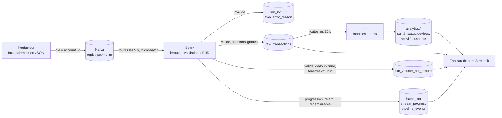

# Plateforme de données de transactions financières en temps réel

[](README.md) [](README.en.md)

[](https://github.com/cheugs/Real-Time-Financial-Transaction-Data-Platform/actions/workflows/ci.yml)       

Projet étudiant de data engineering : un pipeline de streaming qui traite des paiements **synthétiques**
et les transforme en indicateurs de suivi des transactions, affichés sur un tableau de bord en direct.

> Ceci est une démonstration de plateforme de données. Toutes les données sont fictives, et les
> indicateurs d'« activité suspecte » sont de simples règles simulées. Ce n'est **pas** un système
> de détection de fraude utilisable en production.

[](https://cheugs-txn-monitor.streamlit.app/)

**Démo en ligne :** https://cheugs-txn-monitor.streamlit.app/  
*Une rediffusion d'une vraie exécution du pipeline (la chaîne complète Kafka + Spark tourne en local avec Docker, voir la section 13).*

**Sommaire :**
[1. Présentation](#1-présentation-du-projet) ·
[2. Contexte](#2-contexte-métier-et-mission) ·
[3. Objectifs](#3-objectifs-du-projet) ·
[4. Architecture](#4-architecture-du-système) ·
[5. Modèle de données](#5-modèle-de-données-et-schéma-des-événements) ·
[6. Défis](#6-défis-techniques-et-solutions) ·
[7. Traitement](#7-traitement-des-données-et-logique-métier) ·
[8. Choix](#8-choix-techniques-et-compromis) ·
[9. Résultats](#9-résultats-et-tests-de-performance) ·
[10. Tableau de bord](#10-tableau-de-bord-et-supervision) ·
[11. Tests](#11-tests-et-fiabilité) ·
[12. Technologies](#12-technologies-utilisées) ·
[13. Installation](#13-installation-et-exécution) ·
[14. Limites](#14-limites-et-améliorations-possibles) ·
[15. Compétences](#15-compétences-démontrées)

---

## 1. Présentation du projet

Un producteur Python envoie de faux paiements par carte à **Kafka**. Un job **PySpark Structured
Streaming** les lit en continu, les vérifie, supprime les doublons, convertit les montants en EUR
et les compte par minute. Les résultats vont dans **PostgreSQL**, **dbt** construit des tables
d'analyse par-dessus, et un tableau de bord **Streamlit** affiche tout en direct. L'ensemble se
lance avec une seule commande Docker.

**En bref :**
- **Lancement :** `docker compose up -d --build`
- **Ce que le projet démontre :** fenêtres en temps d'événement, gestion des doublons, événements
  en retard avec un watermark, rejeu depuis Kafka, évolution du schéma, et aucune transaction
  perdue ou comptée deux fois après une panne
- **Testé :** 41 tests unitaires et d'intégration, 11 tests de bout en bout, 26 tests de données dbt,
  et une intégration continue (CI) qui passe à chaque commit
- **Mesuré :** 1 000 000 d'événements traités à environ 3 000 événements/s, avec 0 perte et 0 doublon
- **Checklist :** chaque critère d'acceptation est relié à sa preuve dans [docs/CHECKLIST.md](docs/CHECKLIST.md)

## 2. Contexte métier et mission

Les banques et les sociétés de paiement reçoivent un flux continu de transactions. Leurs équipes
doivent savoir, en quelques secondes, combien d'argent circule, si les systèmes suivent le rythme,
et si certaines activités semblent inhabituelles. Les données derrière ces réponses sont
imparfaites : des messages arrivent en retard ou dans le désordre, certains sont envoyés deux fois,
d'autres sont cassés, et le format des messages change avec le temps.

**Mission :** construire une petite plateforme de données, mais réaliste, qui transforme ce flux
imparfait en chiffres **fiables**. Chaque paiement est compté une seule fois, dans la minute où il
a vraiment eu lieu, et les données invalides sont mises de côté avec leur motif au lieu d'être perdues.

## 3. Objectifs du projet

1. Générer des paiements synthétiques réalistes, y compris des données imparfaites volontairement.
2. Les ingérer avec Kafka et les traiter en continu avec Spark.
3. Utiliser le **temps de l'événement** (et non l'heure d'arrivée) pour tous les calculs temporels.
4. Gérer correctement les doublons, les événements en retard, les données invalides et les changements de schéma.
5. Redémarrer après une panne sans perdre ni compter deux fois de transactions, et permettre un rejeu complet.
6. Stocker des résultats propres et bien structurés dans PostgreSQL et les modéliser avec dbt.
7. Afficher les volumes, les délais et des indicateurs simulés d'activité suspecte sur un tableau de bord en direct.
8. Prouver tout cela avec des tests automatisés et un test de performance.

## 4. Architecture du système

```
 ┌──────────┐   ┌──────────────┐   ┌────────────────────────────┐   ┌──────────────┐   ┌───────────┐
 │ producer │──▶│ Kafka        │──▶│ PySpark Structured         │──▶│ PostgreSQL   │──▶│ Streamlit │
 │ (Python) │   │ topic        │   │ Streaming                  │   │ public.*     │   │ dashboard │
 └──────────┘   │ "payments"   │   │  1. lecture du JSON        │   │  brut + flux │   └───────────┘
                │ 3 partitions │   │  2. validation + EUR       │   │  supervision │         ▲
                │ 7 jours      │   │  3a. raw_sink   (dédoubl.) │   └──────┬───────┘         │
                └──────────────┘   │  3b. volume_per_min        │          │                 │
                                   │      (watermark + fenêtre) │   ┌──────▼───────┐         │
                                   └────────────────────────────┘   │ dbt          │─────────┘
                                                                    │ analytics.*  │
                                                                    └──────────────┘
```

| Composant | Rôle | Code |
|-----------|------|------|
| Producteur | Génère de faux paiements, avec des données imparfaites volontaires (doublons, retards, données invalides ou mal formées, 2 versions de schéma) | [producer/](producer/) |
| Kafka | Journal d'événements durable et rejouable. Le topic `payments` est créé par `kafka-init` avec 3 partitions (clé = `account_id`) et une rétention de 7 jours | [docker-compose.yml](docker-compose.yml) |
| Spark | Lit et valide les événements, convertit en EUR, supprime les doublons, construit les fenêtres en temps d'événement et écrit de façon idempotente dans Postgres | [spark/](spark/) |
| PostgreSQL | `public` contient les données brutes, les agrégats du flux et les tables de supervision. `analytics` contient les modèles dbt | [sql/init.sql](sql/init.sql) |
| dbt | Une vue de staging et des tables de marts (santé, statut, devises, activité suspecte). Les tests de données tournent toutes les 30 s | [dbt/](dbt/) |
| Tableau de bord | KPI en direct, volumes, latence, débit, retard Kafka, qualité des données et indicateurs | [dashboard/](dashboard/) |

### Flux de données : le parcours d'un paiement



**Étape par étape :**

1. **Création.** Le producteur crée un paiement (par exemple 34,50 GBP du compte `ACC0042`) avec un identifiant unique `event_id` et un `event_time`, c'est-à-dire le moment où le paiement a eu lieu.
2. **Stockage dans Kafka.** Le message va dans le topic `payments`. La clé est `account_id` : tous les paiements d'un même compte arrivent dans la même partition, dans l'ordre. Kafka enregistre l'heure d'arrivée (`kafka_time`) et garde le message 7 jours, ce qui permet de le rejouer.
3. **Lecture par Spark.** Toutes les 5 secondes, Spark lit les nouveaux messages en un micro-batch. Il enregistre sa position (les offsets Kafka) dans un checkpoint : après une panne, il reprend au même endroit.
4. **Vérification et conversion.** Spark transforme le JSON en colonnes, vérifie les règles de qualité (section 7) et convertit le montant en EUR avec la table `fx_rates`.
5. **Séparation en deux flux :**
   - **Flux brut :** chaque paiement valide est écrit une seule fois dans `raw_transactions`. Une copie avec le même `event_id` est ignorée et comptée dans `batch_log`. Un enregistrement invalide va dans `bad_events` avec son motif.
   - **Flux des fenêtres :** les paiements valides sont dédoublonnés et comptés par fenêtre d'une minute en **temps d'événement**. Un paiement en retard (jusqu'à 10 minutes) met à jour la minute à laquelle il appartient, et le résultat est écrit par upsert dans `txn_volume_per_minute`.
6. **Supervision.** Chaque batch écrit ses chiffres dans `batch_log`, la progression de Spark (débit, retard Kafka) va dans `stream_progress`, et les démarrages, redémarrages et rejeux vont dans `pipeline_events`.
7. **Modélisation par dbt.** Toutes les 30 secondes, dbt reconstruit les tables `analytics` à partir des données brutes (santé du pipeline, répartition par statut et par devise, indicateurs simulés d'activité suspecte) et lance ses 26 tests de données.
8. **Affichage.** Le tableau de bord lit Postgres toutes les 5 secondes. Un paiement apparaît en général **2 à 5 secondes** après son arrivée dans Kafka.

**Où peut finir un enregistrement :**

| L'enregistrement est… | Où il va | Compté dans les fenêtres ? |
|-----------------------|----------|----------------------------|
| Valide et nouveau | `raw_transactions` + sa fenêtre d'une minute | Oui |
| Un doublon (même `event_id`) | Ignoré, compté dans `batch_log.duplicates_skipped` | Non (déjà compté) |
| Invalide ou mal formé | `bad_events`, avec `error_reason` | Non |
| En retard, mais de moins de 10 minutes | `raw_transactions` + la fenêtre de la minute où il a eu lieu | Oui |
| En retard de plus de 10 minutes | `raw_transactions` seulement (gardé, jamais perdu) | Non (fenêtre déjà fermée) |

**Flux de la démo en ligne :** le [tableau de bord en ligne](https://cheugs-txn-monitor.streamlit.app/) ne peut pas faire
tourner Kafka et Spark gratuitement. Le script `scripts/export_snapshot.py` copie donc quelques heures
d'une vraie exécution depuis le Postgres local vers un Postgres dans le cloud (Neon), et le tableau de
bord en ligne lit cette copie en mode démo (section 10).

**Traçabilité :**
- Chaque ligne de `raw_transactions` garde sa `kafka_partition` et son `kafka_offset` : on peut remonter au message Kafka exact. Les messages invalides de `bad_events` ont pour clé la même position Kafka.
- `batch_log` enregistre chaque micro-batch Spark, et `stream_progress` chaque rapport de progression (avec son `run_id`).
- `pipeline_events` enregistre chaque démarrage, redémarrage, panne et rejeu.

## 5. Modèle de données et schéma des événements

**Événement, schéma v1**

```json
{"event_id": "uuid", "schema_version": 1, "account_id": "ACC0042", "merchant_id": "MER007",
 "amount": 34.50, "currency": "GBP", "country": "GB", "status": "APPROVED",
 "event_time": "2026-11-01T12:00:00.123Z"}
```

Le **schéma v2** ajoute deux champs facultatifs : `payment_method` et `device_id`.

| Table | Écrite par | Contenu |
|-------|-----------|---------|
| `fx_rates` | init.sql | Taux de change **de démonstration** fixes vers l'EUR (pas des taux réels) |
| `raw_transactions` | Spark | Chaque événement valide, stocké une seule fois (clé primaire `event_id`), avec `amount_eur` |
| `bad_events` | Spark | Enregistrements rejetés + `error_reason` (table « dead-letter ») |
| `txn_volume_per_minute` | Spark | Nombre, montant en EUR, comptes par statut et délais par fenêtre d'une minute |
| `batch_log` | Spark | Par micro-batch : reçus, insérés, doublons ignorés, invalides |
| `stream_progress` | Spark | Débit, durée du batch et **retard du consommateur Kafka** par batch |
| `pipeline_events` | Spark / script de rejeu | Premier démarrage, reprise depuis le checkpoint, panne, rejeu |
| `analytics.stg_transactions` | dbt | Vue nettoyée avec les colonnes de délai |
| `analytics.pipeline_health_per_minute` | dbt | Latence, événements en retard et versions de schéma par minute |
| `analytics.status_per_minute` | dbt | Répartition par statut |
| `analytics.volume_by_currency` | dbt | Montant par devise (local et en EUR) |
| `analytics.suspicious_activity` | dbt | Indicateurs simulés basés sur des règles |

**Index** (expliqués dans `init.sql`) :
- `raw_transactions(event_time)` : le tableau de bord et dbt filtrent par période de temps d'événement.
- `raw_transactions(account_id, event_time)` : les règles d'activité suspecte regroupent par compte dans le temps.
- `raw_transactions(processed_at)` : le KPI « latence sur les 5 dernières minutes » ne lit que les lignes récentes.
- `stream_progress(batch_timestamp)` : les graphiques lisent la dernière heure de progression.

## 6. Défis techniques et solutions

| Défi | Solution |
|------|----------|
| **Temps d'événement ou temps de traitement :** un paiement peut nous arriver plusieurs minutes après avoir eu lieu | Les fenêtres sont groupées par `event_time`. Trois horodatages sont stockés (`event_time`, `kafka_time`, `processed_at`), ce qui permet de mesurer les délais |
| **Doublons :** la source renvoie environ 3 % des événements | `dropDuplicates(["event_id", "event_time"])` dans Spark garde des totaux justes. `ON CONFLICT (event_id) DO NOTHING` dans Postgres garde la table brute propre. Les copies ignorées sont comptées dans `batch_log` |
| **Événements en retard ou dans le désordre** | Un watermark de 10 minutes : un événement en retard dans cette limite met à jour son ancienne fenêtre. Au-delà, il n'est plus compté dans les fenêtres, mais il est quand même stocké dans `raw_transactions` |
| **Rejeu** | Kafka garde 7 jours d'événements. `scripts/replay.ps1` (ou `replay.sh`) vide les sorties et les checkpoints, et Spark relit le topic depuis le début. Testé : les mêmes identifiants reviennent |
| **Évolution du schéma** | Le schéma Spark contient les champs de toutes les versions. Les événements v1 reçoivent `NULL` pour les nouveaux champs, les champs futurs inconnus sont ignorés, et un `schema_version` absent signifie v1 |
| **Garanties de livraison** | Voir le tableau ci-dessous. Les erreurs de base de données sont réessayées 3 fois, le conteneur redémarre après une panne, et `failOnDataLoss=true` arrête le job plutôt que d'ignorer des données en silence |

**Garanties de livraison, étape par étape :**

| Étape | Garantie | Comment |
|-------|----------|---------|
| Producteur → Kafka | Pas de doublons dus aux nouvelles tentatives | `acks=all`, `enable.idempotence=true` |
| Système source | Au moins une fois (il peut renvoyer) | 3 % de doublons simulés |
| Kafka → Spark | Au moins une fois | Les offsets sont sauvegardés dans le checkpoint. Après une panne, le batch non terminé est relancé |
| Spark → Postgres | Écritures idempotentes | Upserts sur `event_id` / `window_start` / position Kafka. `batch_log` est écrit dans la même transaction |
| **Résultat final** | **Équivalent à « exactement une fois » dans Postgres** | Traitement « au moins une fois » + écritures idempotentes |

**Termes clés :**

| Terme | Signification dans ce projet |
|-------|------------------------------|
| Temps d'événement | Le moment où le paiement a eu lieu (`event_time`), et non celui où nous l'avons reçu |
| Watermark | Combien de temps Spark attend les événements en retard (10 minutes) avant de fermer une fenêtre |
| Micro-batch | Spark lit les nouveaux messages Kafka toutes les 5 secondes et les traite en un petit lot |
| Checkpoint | Un dossier où Spark sauvegarde sa progression pour pouvoir reprendre après un redémarrage |
| Écriture idempotente | Écrire deux fois les mêmes données donne le même résultat qu'une seule fois |
| Upsert | `INSERT ... ON CONFLICT` : insère une nouvelle ligne, ou met à jour la ligne si elle existe déjà |
| Résultat « exactement une fois » | Chaque transaction est comptée une seule fois dans la base, même si elle a été traitée deux fois |
| Table dead-letter | `bad_events` : là où vont les enregistrements invalides, avec leur motif, au lieu d'être perdus |
| Retard du consommateur Kafka | Le nombre de messages présents dans Kafka mais pas encore traités |

## 7. Traitement des données et logique métier

**Étape par étape, pour chaque micro-batch** ([spark/transformations.py](spark/transformations.py)) :
1. **Lire** le message JSON et le transformer en colonnes typées.
2. **Valider.** La première règle non respectée est enregistrée dans `error_reason`, et l'enregistrement va dans `bad_events`.
3. **Convertir** le montant en EUR avec la table `fx_rates`, pour ne jamais additionner des devises différentes.
4. **Stocker** les événements valides dans `raw_transactions` (doublons ignorés).
5. **Agréger** par fenêtre d'une minute en temps d'événement : nombre, total en EUR, acceptés/refusés, délais et retards.

**Règles de qualité des données :**

| Règle | `error_reason` |
|-------|----------------|
| JSON invalide | `malformed_json` |
| `event_id` / `account_id` / `amount` / `event_time` absent | `missing_*` |
| Horodatage illisible | `invalid_event_time` |
| Horodatage plus de 5 minutes dans le futur | `event_time_in_future` |
| Montant inférieur à 0,01 | `non_positive_amount` |
| Devise absente ou inconnue de `fx_rates` | `unknown_currency` |
| Plus de 1 000 000 EUR | `amount_too_large` |
| Statut différent de APPROVED / DECLINED / PENDING | `invalid_status` |

Postgres répète les règles les plus importantes sous forme de contraintes (`CHECK amount > 0`, une
clé étrangère sur la devise, `CHECK status IN ...`), et les tests dbt les vérifient à nouveau sur les données stockées.

**Indicateurs simulés d'activité suspecte** ([dbt/models/marts/suspicious_activity.sql](dbt/models/marts/suspicious_activity.sql)).
Chaque ligne signalée contient une phrase qui explique pourquoi. Les seuils sont des variables dbt dans [dbt/dbt_project.yml](dbt/dbt_project.yml).

| Règle | Signalé quand |
|-------|---------------|
| Fréquence élevée | 6 paiements ou plus d'un même compte en 5 minutes |
| Montant élevé | Un paiement de 3 000 EUR ou plus (comparé en EUR : 3 000 XAF ne sont donc pas signalés) |
| Changement de pays | Des paiements dans 3 pays ou plus pour un même compte en une heure |

## 8. Choix techniques et compromis

| Choix | Pourquoi | Compromis |
|-------|----------|-----------|
| `foreachBatch` + upserts psycopg2 au lieu du connecteur JDBC | JDBC ne sait pas faire `ON CONFLICT`, et ce sont les écritures idempotentes qui donnent des résultats « exactement une fois » | Chaque batch est rapatrié sur le driver. Suffisant pour des milliers d'événements/s, pas pour des millions |
| Deux requêtes de streaming (brut + fenêtres) | La table brute doit garder **tous** les événements, même ceux au-delà du watermark | Les deux requêtes valident leurs écritures à des moments légèrement différents |
| Validation dans Spark et contraintes dans Postgres | Les mauvais enregistrements sont isolés tôt avec leur motif, et la base sert de deuxième filet de sécurité | Les règles existent à deux endroits ; les tests unitaires les gardent cohérentes |
| Taux de change chargés une fois au démarrage | Simple, et les montants ne mélangent jamais les devises | Taux de démonstration fixes. Les changer demande de redémarrer Spark |
| State store RocksDB | L'état des doublons et des fenêtres reste sur disque, pas dans la mémoire de la JVM | Un peu plus lent qu'en mémoire pour de très petits volumes |
| Watermark de 10 minutes | Accepte les retards habituels (de quelques secondes à quelques minutes) | Les résultats d'une fenêtre ne sont définitifs qu'après 10 minutes, et les événements plus tardifs ne comptent pas dans les fenêtres |
| Reconstruction complète par dbt toutes les 30 s | Facile à comprendre | Ne passe pas à l'échelle sur de très grosses tables (des modèles incrémentaux le feraient) |
| JSON plutôt qu'Avro + Schema Registry | Facile à lire et à déboguer | Les règles de schéma sont dans le code, sans registre pour imposer la compatibilité |

## 9. Résultats et tests de performance

Mesuré sur un ordinateur portable : Docker Desktop avec 12 CPU et 8 Go, Spark en `local[4]`. Le détail
complet et l'analyse des goulots d'étranglement sont dans [docs/PERFORMANCE.md](docs/PERFORMANCE.md).

| | 100 000 événements | 1 000 000 d'événements |
|---|---|---|
| Stockés / perdus / en double | 100 000 / **0** / **0** | 1 000 000 / **0** / **0** |
| Débit de bout en bout | **3 725 événements/s** | **2 986 événements/s** |
| Débit de Spark (moyenne par batch) | 4 445 événements/s | 4 366 événements/s |
| Producteur → Kafka | environ 42 000 événements/s | environ 44 000 événements/s |

- **Charge normale** (5 événements/s) : la latence de Kafka à Postgres est d'environ **2,5 s** (médiane) et 4,8 s (p95).
- **Pendant un pic** d'un million d'événements, l'essentiel de l'attente est la file d'attente dans Kafka. Le retard Kafka est monté à 940 000 messages, puis il est redescendu à 0.
- **Principaux goulots d'étranglement :** l'état de dédoublonnage et des fenêtres dans Spark, et le rapatriement de chaque batch sur le driver avant l'écriture.

Lancer un test de performance :

```bash
python scripts/run_benchmark.py 100000
```

## 10. Tableau de bord et supervision

Ouvrez **http://localhost:8501**. La barre latérale propose cinq pages, et chaque page répond à une question :

| Page | Question à laquelle elle répond |
|------|---------------------------------|
| Overview | Le pipeline est-il en bonne santé, et combien d'argent circule ? |
| Transactions | Volumes par minute, montants en EUR, répartition par statut et par devise |
| Pipeline | Débit, retard Kafka, latence, versions de schéma et journal des démarrages, redémarrages et rejeux |
| Data quality | Enregistrements invalides par motif, doublons ignorés, événements en retard |
| Risk indicators | Les trois règles simulées et l'activité signalée |

- Les données se rafraîchissent toutes les 5 secondes, et un filtre de période (15 min à 24 h) se trouve dans la barre latérale.
- Un badge de santé indique *Healthy*, *Catching up* ou *Stalled*, selon le retard Kafka et le temps écoulé depuis le dernier batch.
- Les couleurs des graphiques ont été vérifiées pour les personnes daltoniennes.
- Il fonctionne sur téléphone et tablette : la barre latérale devient un bouton « Menu » qui se ferme après le choix d'une page.
- Les animations sont désactivées quand le système d'exploitation demande de réduire les animations.

**Version en ligne ([https://cheugs-txn-monitor.streamlit.app/](https://cheugs-txn-monitor.streamlit.app/)) :** le pipeline complet est trop lourd
pour un hébergement gratuit. Le tableau de bord en ligne (Streamlit Community Cloud + Postgres Neon) affiche donc
une **copie d'une vraie exécution** en *mode démo*. `scripts/export_snapshot.py` copie les données, et
[docs/DEPLOYMENT.md](docs/DEPLOYMENT.md) décrit chaque étape.

**Tables de supervision** derrière le tableau de bord : `stream_progress` (débit, retard), `batch_log`
(doublons, lignes invalides), `pipeline_events` (reprises), ainsi que les logs Python de chaque conteneur.

## 11. Tests et fiabilité

| Niveau | Ce qui est testé | Comment le lancer |
|--------|------------------|-------------------|
| Unitaires (34) | Générateur, chaque règle de validation, calculs des fenêtres, conversion des devises | `docker compose run --rm tests` |
| Intégration (7) | Vraies requêtes de streaming, un micro-batch à la fois : désordre, retards, au-delà du watermark, doublons, évolution du schéma, données mal formées, reprise depuis le checkpoint | (même commande) |
| Tests de données (26) | dbt : unicité, non-nullité, relations, valeurs acceptées, montants valides, fenêtres non gonflées, pas d'événements futurs, versions de schéma | Lancés toutes les 30 s par le conteneur `dbt` |
| Bout en bout (9) | Sur la chaîne en marche : ingestion, doublons, données invalides, schémas v1/v2/v3, retards, supervision, tableau de bord comparé à la base, dbt, redémarrage de Spark | `pytest tests/e2e -m "not slow"` |
| Bout en bout lents (2) | Panne de Postgres, rejeu complet (**le rejeu vide les tables !**) | `pytest tests/e2e -m slow` |

**Scénarios de fiabilité testés :**
- Spark est redémarré pendant que des événements arrivent. Résultat : rien n'est perdu ni doublé, et la reprise est enregistrée.
- Postgres est arrêté pendant 20 secondes. Résultat : les écritures sont réessayées, Spark redémarre, et tous les événements arrivent.
- Un rejeu complet depuis Kafka redonne exactement les mêmes identifiants d'événements.

**Intégration continue (CI) :** [.github/workflows/ci.yml](.github/workflows/ci.yml) lance les tests unitaires
et d'intégration, puis démarre toute la chaîne dans Docker et lance les tests de bout en bout à chaque push.
Elle passe à chaque commit (voir le badge en haut de la page).

## 12. Technologies utilisées

| Domaine | Outil | Version |
|---------|-------|---------|
| Langage | Python | 3.12 (producteur, tableau de bord), 3.8 (image Spark) |
| Messagerie | Apache Kafka (KRaft, sans Zookeeper) | 3.8.0 |
| Traitement de flux | PySpark Structured Streaming + state store RocksDB | 3.5.3 |
| Base de données | PostgreSQL | 16 |
| Transformation | dbt-postgres | 1.8 |
| Tableau de bord | Streamlit + Plotly | 1.65 / 5.24 |
| Conteneurs | Docker Compose | v2 |
| Tests | pytest, tests dbt, GitHub Actions | |

## 13. Installation et exécution

Il faut **Docker Desktop** avec au moins 4 Go de mémoire.

**1. Créer le fichier de configuration** et y définir votre propre `POSTGRES_PASSWORD` :

```bash
cp .env.example .env
```

**2. Tout démarrer** (le premier démarrage prend quelques minutes, le temps que Spark télécharge le connecteur Kafka) :

```bash
docker compose up -d --build
```

**3. Ouvrir le tableau de bord** sur http://localhost:8501 (interface Spark : http://localhost:4040).

**Lancer les tests :**

```bash
docker compose run --rm tests
```

```bash
pip install -r requirements-dev.txt
```

```bash
pytest tests/e2e -m "not slow"
```

**Tout rejouer depuis Kafka** (Windows ; sur Mac ou Linux, utilisez `sh scripts/replay.sh`) :

```powershell
.\scripts\replay.ps1
```

**Arrêter :**

```bash
docker compose down
```

(`docker compose down -v` supprime aussi toutes les données, les topics Kafka et les checkpoints.)

**Configuration :** chaque paramètre est une variable d'environnement dans `.env` :
- identifiants Postgres
- cadence du producteur
- watermark, taille des fenêtres, intervalle de déclenchement, taille des batchs et nombre de cœurs pour Spark

`.env` est ignoré par git. Seul `.env.example` est versionné.

**Structure du projet :**

```
├── docker-compose.yml       tous les services (+ profil "tests")
├── .env.example             modèle de configuration (à copier en .env)
├── producer/                generator.py, producer.py, benchmark_load.py
├── spark/                   transformations.py (logique), streaming_job.py (entrées/sorties + supervision)
├── sql/init.sql             tables Postgres, contraintes, index, taux de change
├── dbt/                     modèles staging + marts, tests de données
├── dashboard/               queries.py (SQL), theme.py (style), app.py (pages)
├── .streamlit/config.toml   thème du tableau de bord (à la racine pour Streamlit Cloud)
├── tests/                   unit/, integration/, e2e/
├── scripts/                 rejeu, test de performance, export de la copie, requêtes de contrôle
├── benchmarks/              résultats des tests de performance (JSON)
├── docs/                    documentation en français (PERFORMANCE, CHECKLIST, DEPLOYMENT), en anglais dans docs/en/
├── README.md                ce fichier (français) ; README.en.md en anglais
└── .github/workflows/ci.yml
```

## 14. Limites et améliorations possibles

| Limite actuelle | Amélioration possible |
|-----------------|-----------------------|
| Un seul broker Kafka et Spark en mode `local` | Un cluster Kafka avec réplication et un vrai cluster Spark |
| Chaque micro-batch est rapatrié sur le driver avant l'écriture | Écrire en parallèle depuis les exécuteurs (`foreachPartition` ou `COPY` Postgres) |
| Taux de change de démonstration fixes | Un flux de taux de change quotidien, avec des taux qui évoluent dans le temps |
| JSON avec un schéma défini dans le code | Avro ou Protobuf avec un Schema Registry |
| Les tables dbt sont entièrement reconstruites toutes les 30 s | Des modèles dbt incrémentaux |
| Seuils des règles codés en dur | Des seuils ajustés sur les données, ou un vrai modèle entraîné et validé correctement |
| Pas d'alertes, seulement un tableau de bord | Des alertes (par exemple e-mail ou Slack) en cas de retard élevé ou de pipeline bloqué |

## 15. Compétences démontrées

- **Data engineering en streaming :** topics et partitions Kafka, Spark Structured Streaming, fenêtres en temps d'événement, watermarks, dédoublonnage avec état, checkpoints.
- **Fiabilité des données :** écritures idempotentes, « au moins une fois » et « exactement une fois », nouvelles tentatives, reprise après panne, rejeu, gestion des données rejetées.
- **Modélisation des données :** conception d'un schéma PostgreSQL avec contraintes et index justifiés, couches staging/marts dbt avec tests de données.
- **Qualité des données :** règles de validation, évolution du schéma, normalisation des devises, tests automatisés sur les données stockées.
- **Tests :** tests unitaires, d'intégration (streaming) et de bout en bout, scénarios de panne, et intégration continue avec GitHub Actions.
- **Performance :** tests jusqu'à 1 million d'événements, mesure du débit, de la latence, du retard et des ressources, et identification des goulots d'étranglement.
- **DevOps :** Docker Compose, configuration par variables d'environnement, secrets hors de git, installation reproductible.
- **Visualisation des données :** un tableau de bord en direct, structuré, accessible et adapté au mobile, avec Streamlit et Plotly.
- **Communication :** choix, compromis et limites documentés, écrits pour être lus par d'autres personnes.
